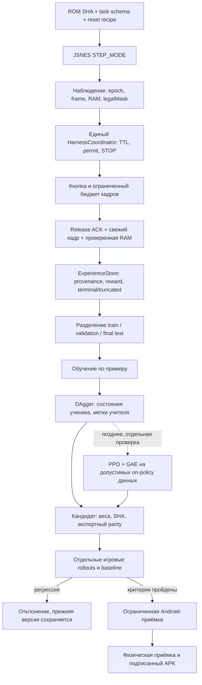

# LocalPilot: стратегия исправления обучения и переходов к релизу

Дата проверки источников: 13.11.2026. Продолжение фаз 3–6 существующего Harness,
один Android APK, прежние JSNES, HarnessCoordinator и хранилище Student.
Это рабочий план с критериями перехода, а не объявление готовности.

## Проверенные первоисточники

1. [AgentEmu: обучение](https://github.com/dk8827/AgentEmu/blob/915bd7e029e6330629fe5feb8c4f978b8dd20813/docs/TRAINING.md).
   Наблюдения конкретной игры, imitation learning, DAgger с метками учителя на
   состояниях самого ученика, затем PPO; проверка PyTorch/native outputs и
   отдельная оценка. Авторы прямо отделяют короткую проверку конвейера от
   прохождения уровня. Применяем порядок BC → DAgger → optional PPO и parity,
   не переносим чужой эмулятор или веса.
2. [CleanRL: DQN](https://github.com/vwxyzjn/cleanrl/blob/fe8d8a03c41a7ef5b523e2e354bd01c363e786bb/cleanrl/dqn_atari.py).
   Replay, исследование, отдельная target-сеть, периодическая синхронизация,
   сохранение и оценка. У LocalPilot прежний target считался из одновременно
   обновляемых online-весов. Первый локальный шаг — отдельный снимок target.
   Atari CNN, размеры буфера и их гиперпараметры к нашей маленькой сети
   автоматически не применимы. Это механизм для сравнения, не готовый рецепт.
3. [Gymnasium: termination / truncation](https://github.com/Farama-Foundation/Gymnasium/blob/68c3f95def1b9d91922db5363a28dc1d4a83a960/docs/tutorials/gymnasium_basics/handling_time_limits.py).
   Завершённая цель отключает bootstrap; внешний таймлимит не равен terminal.
   При STOP с недоказанным post-state запись вообще не годится для TD/PPO.
   При чистом cutoff с подтверждённым последним наблюдением bootstrap допустим.
4. [Stable-Retro](https://github.com/Farama-Foundation/stable-retro/blob/5a7713fdf379f07ad02fa4f4fb69135eaf711fb0/README.md).
   Настоящие консольные среды Gymnasium и отдельная интеграция игры. Используем
   как ориентир для контракта среды и настольных сравнений. Ядра имеют отдельные
   лицензии; никаких новых ядер, ROM и библиотек в APK в этом изменении нет.

Исходники прочитаны через подключённый GitHub. SHA выше фиксируют изученные
версии. Возможности авторских проектов не приписываются LocalPilot.

## Причина текущего отказа

Подтверждено PR #135: в старом E2E Node сам нажимал RIGHT вместо передачи
экспортированного решения. После исправления Student за 12 действий получает
-73/-73/-73, random -43/-44/-44, scripted +59/+89/+59 на трёх fresh-ROM условиях.
Ни одна стратегия не достигла цели в этом бюджете. Отдельные ROM-сеансы
повторяют одну траекторию: разные epoch не обеспечивают разнообразие данных.

Гипотезы, которые нужно различить экспериментами: движущийся TD target,
непокрытые действия UP/DOWN, смещение распределения состояний при самостоятельной
игре, overshoot около цели из-за шага 16 кадров. Не объявлять каждую гипотезу
первичной причиной без отдельного сравнения. Сеть остаётся sandbox candidate.

## Схема одного рабочего контура

Учитель только предлагает/размечает. Он не получает второго исполнителя.
Ни обучение, ни сеть, ни внешний инструмент не обходят общий gate.

## Порядок работы и критерии перехода

### 1. Зафиксировать измерение и стабилизировать TD — текущий шаг

Сохранить отрицательный baseline, веса и сценарии PR #135. В существующем
HomebrewStudentNetwork заменить online bootstrap отдельным target snapshot,
синхронизация каждые 10 проходов как начальный эксперимент, без подбора на test.
Проверить отсутствие градиентов target, детерминизм, сериализацию и полный
rollout. Успех шага означает корректность механизма, не выигрыш модели.

### 2. Покрыть состояния и действия

Через тот же реальный JSNES собирать разнообразные train reset-prefixes и
траектории по всем шести действиям, от обеих сторон цели, сверху/снизу, около
границ и зоны overshoot. Записывать ROM SHA, рецепт reset, seed политики,
epoch, время/кадры, веса, истинные RAM до/после, reward и источник метки.
Не выдавать seed выбора действий за seed самой ROM. Отклонять дубли одного
перехода; отчёт покрытия состояния/действия обязателен.

Разделить заранее наборы reset-рецептов: train, validation и final test.
Совпадающие состояния отметить явно; статистика не должна скрывать повторные
детерминированные эпизоды. После использования test для выбора модели он
становится validation, для финального вывода нужны новые условия.

### 3. Обучение по примеру, затем DAgger

Обучить существующую маленькую сеть имитации проверенного учителя как
отдельный эксперимент с явной схемой checkpoint, не менять смысл старых Q
весов молча. Учитель сначала проходит собственный экзамен. Неудачный teacher
не является эталоном. DAgger добавляет метки для реальных посещённых учеником
состояний только из train; test не попадает в replay. Сравнить чистую imitation,
TD с frozen target и текущую версию на одинаковом бюджете.

### 4. Независимый экзамен и отбор

На сохранённых/reset-prefix условиях сравнить random, scripted teacher,
старую и новую модели. Не менее пяти заранее выбранных training seeds для
оценки устойчивости; наборы и бюджеты фиксируются до запуска. Отдельно
success rate, return, distance, overshoot, abstention, число кадров/действий,
STOP и нарушения gate. Для детерминированной ROM повтор того же reset сам по
себе не даёт независимой статистики. Нужны разные допустимые начальные условия.

Экспортированные и рабочие веса должны давать одинаковые решения. Нет
регрессии безопасности; новый кандидат превосходит предыдущий на зафиксированном
validation, а пригодность подтверждает нетронутый test. При неуспехе сохранять
исходные веса, manifest и полный отрицательный отчёт. Внешний таймлимит не
подменять игровым проигрышем. Недоказанная награда остаётся null.

### 5. PPO/GAE — после работающего baseline

Только после предыдущих шагов: отдельная on-policy схема oldLogProb/value,
legalMask, durationFrames, terminal/truncated; корректный bootstrap и учёт
длительности действия. Сравнить с неизменённой imitation baseline. PPO не
лечит неправильный reward, дубли данных или ошибочную отправку кнопок.

### 6. APK и релиз

Новая Android-матрица API30/35/36 на одном SHA, действие Student через общий
контроллер и немедленный STOP; настоящая установка на физический телефон и
планшет/целевое устройство; измерение CPU и реального Vulkan отдельно.
ZIP CRC, источник, SHA, постоянная совместимая подпись и возможность rollback.
При незавершённом критерии release_ready=false. Новых пользовательских APK нет.

## Что уже выполнено и как продолжать

PR #135 реализует передачу решений сохранённой сети в настоящие CPU/PPU
rollouts и отчёт об отклонении регрессии. Следующее изменение в этом же PR
вводит frozen target и запускает тот же benchmark. Результаты публикуются
отдельно от гипотез в существующем Whole System CI, без нового оркестратора.

Команды: java tests/HomebrewStudentNetworkVerify.java; затем существующая
команда tests/nes_student_real_onpolicy.cjs из whole-system-acceptance.yml.
Android-проверки идут через существующие workflows. Зафиксировать SHA каждого
эксперимента и не переносить зелёный статус между коммитами.

## Фактический результат первого эксперимента

На прежнем наборе из 24 train и 8 holdout переходов, с фиксированными
110 проходами, шагом обучения и seed: frozen target каждые 10 проходов.
Проверки target immutability, направления одиночного TD update и точного
детерминизма PASS; export/reload parity PASS; три integration contract PASS.

Offline TD MAE изменилось с 0.016083670021422747 на 0.017227226537469553.
Student return остался -73/-73/-73; остальные стратегии без изменений.
Кандидат остаётся REJECTED_ONPOLICY_REGRESSION. Гипотеза «отдельная target-сеть
сама исправит игру на прежних данных» не подтвердилась. Реальная причина
провала не объявляется установленной; дальнейший проверяемый шаг — покрытие
действий и состояний, затем BC/DAgger по плану. Не подбирали параметры под test.

## Шаг 2: выполненный эксперимент diverse-v1

В том же NES runner добавлен второй, детерминированный протокол сбора:
40 настоящих ROM-сеансов, разные 12-действийные reset-prefixes, затем смесь
60% предложений геометрического teacher и 40% случайных действий, безопасные
границы без wrap. Prefixes исполняются ядром, RAM вручную не подменяется.
Это action RNG seed 270113, не фиктивный seed ROM. Все шаги имеют ровно 16
кадров и release. Goal reward перепроверяет production Java код.

Получено 794 перехода: 770 train (39 сеансов), 24 holdout (40-й сеанс).
Действия A/B/UP/DOWN/LEFT/RIGHT: 46/74/117/92/139/326. TD обучение осталось
тем же, отдельный обучающий движок не добавлялся. Импортные записи имеют
реальную SHA-256 набора данных, вместо вымышленного SHA модели-учителя.
Весовой файл после повторного обучения совпал побайтно:
`f09d4915e3de82b3f80224042770fdb0bbeab408c3ff1b7f0af16cd447f1da0b`.

На прежних трёх validation условиях return Student +61/+91/+91, вместо
-73/-73/-73; random -43/-44/-44, scripted +59/+89/+59. Student завершает
4/6/6 действий на distance 3/4/4 и выбирает NONE; цель distance <=2 **не
достигнута**. Отбор различает return_improved и all_tasks_reached:
`SHADOW_ONLY_GOAL_NOT_REACHED`, automatic_promotion=false, release_ready=false.

Holdout содержит 4 перехода, совпадающие с train по action + pre/post X,Y.
Это явно записывается в JSON; разные epochs не трактуются как независимые
состояния. Три использованных validation запуска уже не являются final test.
Результат подтверждает улучшение в этих условиях, не общую способность играть.

Whole System выполняет legacy и diverse-v1, сохраняет оба JSON с траекториями,
reset recipes, ROM/core/dataset/weights SHA, покрытием и исходом отбора.
Ни веса лабораторного эксперимента, ни ROM не публикуются как APK-артефакты.
Существующая Android-сеть/контроллер в этом шаге не изменяются.

Следующий критерий: разобрать последние 16-кадровые шаги и overshoot,
проверить действие с ограниченной длительностью через тот же типизированный
Harness (без ослабления TTL/STOP), затем BC/DAgger и новый нетронутый test.
Не менять порог цели или ожидания теста для получения успеха.
