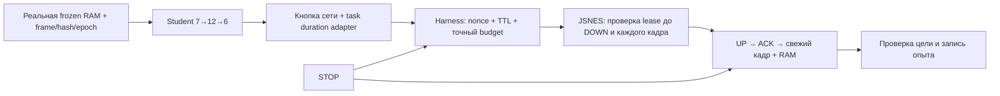

# Точная NES-политика, STOP и проверяемое обучение · 13.11.2026

База: PR #135, `ba6cbd90b59cadde9f3bcf49c9e07b3c36f9785e`.
Ветка: `fix/harness-precision-imitation-20261113`. Один пользовательский APK,
прежние JSNES/HarnessCoordinator/ModelLab. Это кандидат, не стабильный релиз.

## Исправленная цепочка

Старый шаг всегда длился 16 кадров; Student застревал в 3–4 пикселях от цели.
Теперь сеть выбирает кнопку, а task-specific адаптер по подтверждённой RAM
выбирает ограниченный бюджет 4/8/16 кадров. Ни цель (192,112), ни допуск
Manhattan <=2 не изменены. Это гибридная политика, не обучение длительности
весами сети. GGUF сохраняет контракт 16 кадров. Короткие действия доступны
только Student в STEP_MODE с тем же одноразовым владельцем.

Низкая разница между вероятностями двух направлений к одной цели больше не
равна неизвестному направлению. В известном homebrew-профиле допустима
неизменённая argmax-кнопка сети, если суммарная масса направленных к цели
кнопок >=0.99. Направление не подменяется учителем при оценке; если argmax
направлена от цели и сама не прошла обычный порог уверенности, остаётся NONE.
Это task-specific admission, не калиброванная универсальная вероятность и
не разрешение на системные жесты или управление чужими ROM.

## STOP и безопасность

- Синхронный JavaScriptInterface проверяет актуальный permit nonce, epoch,
  stopRevision, TTL и точное число кадров до нажатия и перед каждым core frame.
- JS запрещает повтор nonce. Частичный шаг освобождает кнопки и не публикует
  завершённую RAM-награду. Уже разрешённый core frame может закончиться после
  запроса STOP на Java UI; нулевая задержка между потоками не заявляется.
- STOP_PENDING блокирует всех владельцев до JS ACK об отпускании кнопок.
  ACK подтверждает освобождение, не игровой успех. Нет ACK → Fail-Closed,
  явное состояние и перезагрузка ROM. Нет автоматического повторного ввода.
- Поздний callback не меняет revision ожидаемого ACK и не отзывает новый permit.
  Ответ со старым nonce не потребляет новое наблюдение.
- Epoch уникален между Activity в процессе; уничтожение старой Activity
  не останавливает владельца другой ROM. Callback результата проверяет реальную
  длительность и deadline, арифметика кадров не переполняется через int.
- Ручные START/SELECT снова проходят собственный MANUAL permit; модели и
  сценарные автономные роли не получают эти кнопки.

## Обучение в существующей сети

В одном HomebrewStudentNetwork сохранён TD-эксперимент и добавлена отдельная
явно маркированная objective IMITATION. Учитель размечает подтверждённые
наблюдения точной homebrew-задачи, выбирая ось с большей ошибкой. Никакие
синтетические RAM-переходы не записываются как реально исполненные.

Тренировка классификатора: 200 проходов, фиксированная инициализация и shuffle,
двукратный вес состояний на расстоянии <=16. Метрика — ошибка классификации
на отдельном сеансе против majority baseline, а не TD MAE и не win rate.
Старый только-RIGHT набор не проходит этот offline gate, если не превосходит
majority baseline. На terminal task state policy возвращает NONE.

DAgger выполняет три раунда только на train reset-prefixes и заранее заданной
сетке рабочего пространства. Метки вычисляются для посещённых учеником
состояний. При NONE teacher может двигать ТОЛЬКО тренировочный rollout;
такие fallback считаются отдельно. При validation/frozen exam fallback нет.

Контрольные точки содержат objective и schema V3; SHA Android-кандидата
учитывает objective/schema. Старые файлы не перезаписываются: новая Student
имеет отдельное имя. Goal journal V2 и NES trial V2 допускают короткие шаги;
V1 записи по-прежнему читаются без изменения wire identity и старой семантики.
Неизвестная схема, некорректный checksum или неподтверждённый кадр отклоняются.

## Выполнено локально

- HarnessCoordinator: 52 отрицательные/положительные проверки, включая stale
  nonce/epoch/callback, TTL, STOP ACK, точную длительность и ручной START.
- Целая упаковываемая JS-страница + настоящий JSNES CPU/PPU: 4/8/16 кадров,
  pause/reset, release, nonce replay, mid-step revocation без task evidence.
  Android bridge в этом Node-тесте моделируется; отдельная JVM проверяет lease.
- JVM: обучение/детерминизм, goal reward, старые/новые журналы, export parity,
  контракты ModelLab, NES bridge/frame epoch; исходные контроллерные тесты.
- Android Java compile и lint выполнены; итоговый SHA и повторные результаты
  сборки/матрицы фиксирует CI, локальные результаты не наследуют статус нового SHA.
- Новый полный DAgger-прогон с data seed 270113: 15/15 известных стартов дошли
  до неизменённой цели при бюджете 192 кадров.
- Отдельный экзамен замороженных весов: 20/20 новых различных начальных RAM
  состояний и reset recipes, seed 781871, бюджет 512 кадров. Обучения и изменения
  весов во время экзамена нет. Teacher 20/20, random 0/20.
- Файл весов полного прогона:
  `77fadb8d4df2c108de8d5184f55d65bf5f56677dfc498b20c6e822ac4f2ba025`.
  Это hash лабораторного checkpoint, не подпись APK и не доказательство
  фактического использования этих весов на телефоне.

Ранние отрицательные результаты сохранены в истории: TD -73; разнообразный
TD +61/+91/+91 без достижения цели; classifier/DAgger V2 имел 13/15, хотя
другой набор показывал 20/20. Последнее не скрывало известных ошибок.
Обновление admission V3 проверено и на известных ошибках, и новым экзаменом.
В отдельном эксперименте подтверждено, что смена schema/admission сама по
себе меняет hash файла, но не численные веса; это не выдаётся за обучение.

## CI и критерии допуска

Существующий Whole System выполняет отрицательные TD-контроли, DAgger,
замороженный экзамен и verify_harness_task_reports.py. Валидатор заново
вычисляет награды/достижение цели по каждому переходу, проверяет число случаев,
budget, identity source/core/ROM/dataset/weights, отсутствие смены весов и
повторного обучения, непересечение reset recipes и 20 разных RAM-стартов.
Не допускает скрывать известные неудачи. Два contract-теста включают 16
отрицательных мутаций; synthetic fixtures не публикуются как игровая статистика.

Кандидат должен достигать цели во всех случаях, не уступать правильному
teacher более чем на два балла (из-за допуска конечной позиции <=2), и
превосходить random суммарной наградой и количеством достижений. Это заранее
объявленный task gate, не требование обогнать оптимального учителя строго
в каждом эпизоде. Все стратегии получают одинаковый frame budget.

Матрица data seeds: 270113 в основном job, 571/9091/12097/65537 в отдельных
jobs того же workflow и того же runner/производственной сети. Это различные
наборы данных, не фиктивные seed самой ROM; seed инициализации сети фиксирован.
Новый CI имеет статус PENDING до фактического завершения каждого job.

## Релизные ограничения

`TASK_EVIDENCE_PASS` означает готовность headless-задачи к Android-приёмке.
`android_acceptance=false`, `physical_device=false`, `release_ready=false`.
Это только точный оригинальный homebrew-профиль, не победы в сторонних NES ROM,
не обучение GGUF, не PPO/GAE и не доказательство Vulkan на POCO.

Нужны реальная Android проверка Student→permit→WebView→RAM/journal,
физическая приёмка телефона/планшета, постоянный совместимый signer и остальные
незакрытые фазы общего плана (строгий offline/полный RL-контур). На последней
проверке GitHub environments=0, ADB devices=0. Никакой временный ключ не
создавался, приложение пользователя не удалялось. Полный релиз не объявляется.
