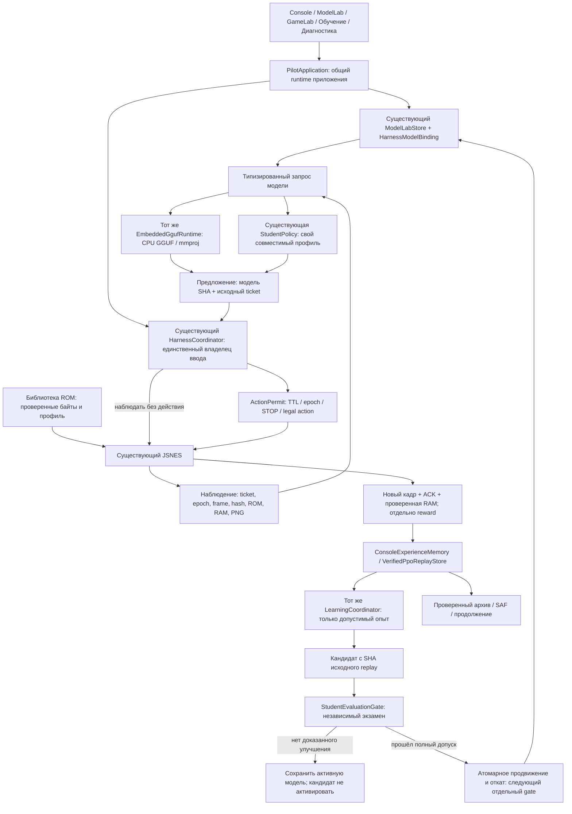

# Связанный runtime LocalPilot: схема и порядок реализации

Дата15.11.2026. База `fbbbeb9cb4ffa54ecc26582e4a640b963b80b8d3`, версия0.8.4/code56.
Это детализация G2/G4 существующего [Control Tower #159](https://github.com/GiVscSon/LocalPilot-Android/issues/159),
[RFC](LOCALPILOT-HARNESS-RFC-v1.md) и [общих этапов](LOCALPILOT-CONTROL-TOWER-STAGES.md).
Не заменяет общую очередь и не создаёт другого управляющего движка.

## Общая схема

Экран не владеет моделью или игровым вводом. Выбор модели меняет общий registry;
Play получает решение от того же native runtime, не открывая экран ModelLab ради
каждого автоматического хода. Все предложения проходят прежний контроллер.
GGUF с неизвестной наградой не становится PPO-опытом. Несовместимые Student и GGUF
не обмениваются весами. Установка файла не означает INFERENCE_PASS.

## Подтверждённые разрывы базы

- Автоматический GGUF путь передаёт кадр через Intent в ModelLabActivity и возвращает
  MOVE Intent. Смена экрана участвует в игровом цикле; NES уходит в onPause.
- Каталог и native runtime живут в static-полях ModelLabActivity, хотя должны
  принадлежать приложению. ModelLabApp имеет отдельное управление lifecycle.
- Ticket/epoch/frame уже защищены HarnessCoordinator, но не образуют общий
  типизированный контракт обращения к модели вне Activity.
- PPO-кандидат и CI-экзамен существуют; on-device promotion/rollback отсутствуют.
- В RFC упомянут ConsoleAgentBridge.java, но такого файла в текущем main нет:
  фактический транспорт — Intent. Не создавать фиктивный «существующий» bridge.

## Этапы в существующих gates

1. **G2: общий runtime и прямой канал модели.** Перенести владение прежними
   EmbeddedGgufRuntime/ModelLabStore в объект Application; ModelLab и Console
   используют его. Добавить typed observation/reply с тем же настоящим Ticket.
   Автоматический GGUF ход выполняется без смены Activity. STOP/фон/замена binding/
   TTL отменяют ответ; busy остаётся до фактического завершения JNI.
   Выход: JVM отрицательные тесты транспорта; Android compile/Lint; настоящий
   Android отказ без модели; отдельно реальный GGUF→NES trace без UI-переключений.
2. **G4: единый контекст эпизода.** Протянуть episodeId/epoch/ROM SHA/model SHA/
   stopRevision/evidenceRef через router, transition и replay. Console/ModelLab/
   Episodes/Learn читают одну проекцию. Проверить смену модели/ROM и старые callbacks.
3. **G5: завершённый lifecycle кандидата.** На том же runtime выполнять независимый
   on-device экзамен с минимум20 парами по общему контракту; отделить NO_IMPROVEMENT
   от ошибки исполнения. Сохранить кандидата/отказ/метрики; внедрить атомарное
   продвижение с сохранением прежних весов и проверенный откат. Не активировать
   старые unbound кандидаты и результаты из неподтверждённого JSON.
4. **G1/G4: нормальные ROM-профили.** После действительной проверки ROM определить
   пространства наблюдений/действий и reward adapter конкретной игры. Сначала shadow,
   затем разрешённая автоигра, отдельные модели и статистика. Импорт произвольной ROM
   сам по себе не разрешает автономный ввод и не создаёт награду.
5. **G0/G3/G6: общая приёмка.** Один pinned source и пользовательский APK; независимые
   положительные/отрицательные проверки всего пути; API30/35/36×phone/tablet;
   permanent signer, upgrade/data retention, offline и физические измерения.
   BUILD/UI/EMULATOR не равны DEVICE/RELEASE.

Первым реализуется этап1. Остальные этапы здесь запланированы, не объявлены выполненными.
G1 longplay уже занят PR #168; не дублировать его. PR #150 рассматривается отдельно
для более строгого экзамена, старую ancestry #156/#157 поверх main не переносить.

Откат первого этапа — архивная ветка archive/main-before-connected-runtime-20261115
на fbbbeb9. Ключ подписи, модели, ROM и пользовательский опыт не очищаются.

## Реализация этапа1 в PR #170

IMPLEMENTED / CI_PENDING, версия кандидата0.8.5/code57:

- `NesModelHost` — типизированный Application-port: настоящий Ticket, ROM SHA,
  выбранная модель/SHA, RAM и ограниченный PNG; ответ не может поменять binding.
- `HarnessModelRuntime` — один владелец прежних ModelLabStore/EmbeddedGgufRuntime
  в PilotApplication/ModelLabApp. Activity хранит только ссылки на этот объект.
- Автоматические GGUF4хода вызывают порт прямо из NesEmulatorActivity, оставаясь
  в той же Activity. Ручной явно запрошенный анализ через ModelLab сохранён.
- STOP/фон/смена binding/TTL отменяют или отбрасывают ответ. Очередь не признаёт
  JNI свободным раньше завершения. Последний binding проверяется перед вводом.
  Маска встроенной RAM-задачи отсекает переход через8-битный край.
- Console и ModelLab читают общую фазу запроса/engine/catalog; модель не получает
  ActionPermit и не исполняет кнопки. Прежние replay/PPO/архив не заменены.

Локально:22 JVM негативных/положительных контрактов порта,83 Harness assertions,
3 Python proof-label tests и9 single-runtime guard tests PASS; основной и отдельный
ModelLab Java/AndroidTest compile/Lint PASS. Это не настоящий GGUF инференс.
В существующий All-in-One CI добавлены Android recreation/no-model/duplicate/STOP
контракты на том же x86APK и отдельный положительный GGUF→JNI→4NESшага без
переключения Activity. Последний тест загружает только закреплённый публичный
Pocket GGUF через production ModelLabStore, не подставляет ответы. Результат CI
ещё требуется; INFERENCE_PASS/ACTION_PASS/TRANSITION_PASS сейчас UNKNOWN.

### Первый Android прогон и исправление первичной причины

На коде `0abbe6a` (тестируемый merge `78c75afc`) Android recreation/no-model/
BUSY/STOP контракт PASS, шесть API30/35/36×phone/tablet и общий matrix-report PASS.
Публичный Pocket GGUF действительно импортирован:191896672байта, закреплённый SHA
`a281c127e388b16537fd3f5d31ab32d3f87739e6dc514ac1093c80d9eac8d097`.
Сквозной G2 FAIL: `NO_FRESH_VERIFIED_NES_TRANSITION`; выпуск не разрешён.
Прогон: https://github.com/GiVscSon/LocalPilot-Android/actions/runs/43747633866.

Причина воспроизведена на настоящем JSNES с bundled ROM: при RIGHT координаты X
159→174→189 и полный framebuffer менялись, но выборочный отпечаток (каждый241-й
пиксель) оставался1019106887. Это теряло движение маленького спрайта и приводило к
корректному fail-closed по недостоверной метрике. Теперь хешируются все пиксели.
Подтверждение RAM, модель/SHA, TTL, STOP и требование PIXELS_DIFFER сохранены.
Старые сохранения валидируются прежним алгоритмом и переходят на новый отпечаток
только в новой эпохе; неизвестный алгоритм отвергается. Тест полного HTML+JSNES
воспроизводит старый дефект, проверяет четыре движения,40ходов/сохранение/7ходов
продолжения и точное восстановление старого архива. Новый Android G2 обязателен.

Повтор того же SHA после DNS-сбоя дал три настоящих GGUF→JNI→LEFT→NES-перехода:
кадры16→32→48→64, все PIXELS_DIFFER. Artifact14176770932/run43749581283.
Измеренные inference latency70362/72017/74081мс: общий240с бюджет теста не вмещал
четыре допустимых120с запроса. Бюджет испытания исправлен на4×120+30с;
TTL/permit/STOP в приложении не меняются. В setup допускаются максимум3 попытки
только при DNS UnknownHostException, без повторов игровых действий/ошибок модели.
Это подтверждение связи, не качества: модель выбирала LEFT против правой цели,
поэтому улучшение стратегии/обобщение не доказаны. Полный4-ходовый gate ещё нужен.

Ревью очереди также выявило продление возраста наблюдения после inference:
`aiIssuedAt` присваивался при получении предложения. Теперь сохраняется настоящий
`ticket.issuedAt` при запросе кадра; задержка350мс перед вводом учитывается в том
же исходном TTL. Поздний ответ не получает нового срока для жеста.
