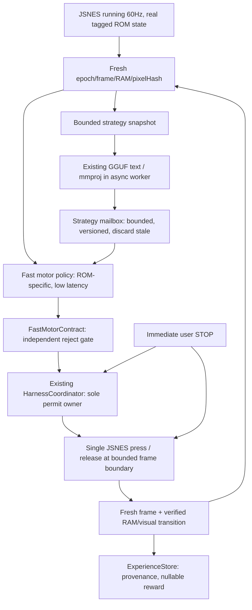
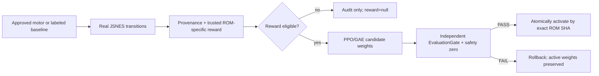

# LocalPilot Fast Motor: real-time control in one Harness

Status: PROPOSED architecture and **M0 host contract implementation only**.
Date: 2026-11-18. Stacked after Draft #195, not merged into main.
Authority: [LOCALPILOT-HARNESS-RFC-v1.md](LOCALPILOT-HARNESS-RFC-v1.md) and
[LOCALPILOT-HARNESS-EXECUTION-PLAN.md](LOCALPILOT-HARNESS-EXECUTION-PLAN.md).
This plan adds no new JNI, second input owner, new emulator, background network call,
reward oracle or bypass of STOP. It does not close the earlier Phase 0-6 release gates.

## Evidence and external implementation references

- [Sample Factory architecture](https://www.samplefactory.dev/06-architecture/overview/):
  separates environment rollout workers, inference workers and learner. Transfer:
  motor decisions should not wait for a heavy strategic inference; verify stale
  policy versions after policy updates. Do not copy its distributed worker
  machinery into one Android process.
- [Arcade Learning Environment specifications](https://ale.farama.org/env-spec/)
  and [environment action/frame controls](https://ale.farama.org/environments/):
  bounded frame actions, explicit legal actions and reproducible evaluation.
  Transfer: every motor action carries a frame count and a new independently
  observed core state; a frame advance alone is not a positive reward.
- [Voyager Minecraft agent](https://github.com/MineDojo/Voyager):
  high-level LLM goal/skill choice is distinct from repeated low-level actions.
  Transfer: GGUF may suggest an explicit strategy intent, never send a raw
  real-time button or write an input permit.

Existing LocalPilot observations on exact pinned VOID LANCER ROM:
- Draft #195 on 2026-11-18: Pocket GGUF had verified `START` and eight
  `A` decisions, 100 points and one kill on API35 x86_64 emulator.
  Inference took 8-17 seconds per decision, so it cannot be the realtime motor.
- `StudentPolicyNet` currently has a genuine 64->64->64 actor/value learner
  for the **built-in homebrew task only**. Its weights must not be relabeled
  as trained for VOID LANCER.
- Existing `HarnessCoordinator` owns epoch, TTL, STOP revision, and permits.
  `NesEmulatorActivity` has real JSNES STEP_MODE. `retroAiStep` deliberately
  requires paused/frozen STEP_MODE, so using it in REALTIME_MODE without changes
  is an error. JSNES normal `onFrame` reports approximately every 15 frames.
- The latest `sustained-nes-256` FAIL was an app navigation/launcher failure
  before any 256-action proof. Keep it separate from inference or policy quality.

## Scheme A: real-time (target, NOT implemented yet)

LLM may propose `GOAL=SURVIVE|FIRE|TARGET_ENEMY` with bounded TTL and
source model SHA, never `button` or `press`. A stale strategy is dropped,
but the motor continues only if its **own** current-session permit remains
valid. If no trusted motor profile/policy exists, the agent must remain
inactive or run a separately identified explicitly opt-in heuristic baseline.
No silent fallback and no fabricated Student attribution.

## Scheme B: learning and promotion (target)

Never train with `reward=null`, pixelsDiff, input ACK, test harness score
or unverified GGUF recommendations. Separate `RETRO_EMULATED`,
`VERIFIED_REAL`, `SIMULATED_GAME` and `SYNTHETIC` provenance.

## Work units, strict sequential gates

### M0. Contract and negative host tests (this Draft PR)
- Added `FastMotorContract`, a **non-executing** ROM-specific admission
  predicate: exact SHA, epoch, timestamp <=250ms, frame/hash, STOP revision,
  singleton-owner snapshot, current PLAYING phase, legal buttons, available
  bomb, 4/8/16 frame duration, explicit heuristic opt-in or evaluated
  Student exact weight SHA.
- Added host JVM tests and registered `java tests/FastMotorContractVerify.java`
  in the current All-in-One source gate. These are synthetic **contract**
  assertions, never proof of gameplay.
- Exit: host gate PASS on exact branch SHA; all unrelated tests unchanged.
  Motor **still not attached**, no additional autonomous play claimed.

### M1. A real non-neural fast baseline on the exact test ROM (next Codex unit)
- Add an explicit `EXPLICIT_ROM_HEURISTIC` actor to the existing coordinator
  rather than impersonating `STUDENT` or `GGUF`. Require opt-in.
- Read *actual tagged* VOID LANCER `state=PLAYING`, enemy and threat
  coordinates. A small pure CPU motor chooses action in <=4/8 emulated frames;
  title/menu/unknown ROM or stale state DENY. No scripted fallback to
  game-progress PASS. Never attribute heuristic play to a neural model.
- Route decisions through **one** `HarnessCoordinator` input permit and
  existing JSNES, with explicit down/release/fresh-core-frame evidence.
  Maintain manual/STOP priority and probe lifecycle on pause/ROM switch.
- Exit: real pinned ROM, 100+ independently correlated actions, exact action
  origin, no input after STOP, negative owner/epoch/ROM tests; do NOT require
  positive score as an action transport condition, but do require score/kills
  separately for `GAME_PROGRESS_PASS`. No user-ROM generalization claim.

### M2. Truly realtime motor without blocking on GGUF
- Add a controlled opt-in REALTIME route: short periodic *fresh* observations,
  bounded single-input leases and release at emulated-frame deadlines.
  The current `retroAiStep` cannot be used because it requires frozen STEP.
  Ensure the action is not a loose `retroButton` call without a permit.
- Asynchronously snapshot strategy observations; GGUF may take seconds.
  Gate late intents by ROM SHA, epoch, objective, request ID and strategy TTL;
  strategy cannot override STOP or own the button actuator.
- Exit: video/ROM proof that JSNES continues stepping while GGUF is busy,
  1000 bounded motor decisions under thermal/battery budget, 0 late input,
  p50/p95/p99 decision and input-to-confirmation measured on physical ARM64
  before device performance claims. Targets for physical evaluation, NOT facts:
  policy p95 <=25ms; first motor response <=4 emulated frames when capable.

### M3. Trained ROM-specific StudentPolicy
- Version a separate `VoidLancerObs64` schema; never apply the homebrew
  x/y goal student and its weights to VOID LANCER.
- Begin with a documented heuristic teacher or verified model episodes,
  then learn a candidate from **actual** eligible emulator transitions and
  trusted ROM score/lives/kills reward; no self-generated teacher fraud.
- Verify SHA256 weights.bin before/after, changed finite parameters,
  training update logs and disjoint held-out episodes. EvaluationGate must
  reject degraded policies and atomically restore the last approved weights.
- Exit: `TRAINING_PASS` + `EVALUATION_PASS` on true ROM evidence,
  candidate/active identity pinned by the ROM SHA, no promotion on host tests.

### M4. Strategy <> motor arbitration and UI
- Use existing ModelLab registry with MNN-Pocket, Qwen, LFM, mmproj-capable
  models. Never invent or bundle a second inference runtime.
- One panel reports `motorSource`, `motorPolicySha`, `strategyModelSha`,
  `currentGoal`, `goalAgeMs`, `fps`, `decisionP95`, STOP status,
  rejected proposals and gameplay outcomes, with UNKNOWN displayed honestly.
- Exit: strategy replacement, native cancel and stale response cannot override
  an active motor permit or ROM/epoch identity.

### M5. Physical ARM64 acceptance and release review
- Revalidate package, compiled resources, DEX, ELF, ROM SHA, debug/release
  signer, persistent release key, update continuity, API30/35/36 UI matrix.
- On actual POCO X7 Pro, collect CPU/GPU load, thermal, memory, p50/p95/p99,
  long episode, manual takeover, background/foreground, explicit STOP and
  corrupted ROM/weights. No Vulkan PASS without native device evidence.
- Exit: all old Phase 0-6 gates plus physical signature/update and zero
  safety violations. Do not merge or publish automatically.

## Critical interface boundary

`FastMotorContract.inspect(proposal, current, nowElapsedMs)` returns
`ADMISSIBLE` or a precise denial. It NEVER calls JSNES, issues a
`HarnessCoordinator.ActionPermit`, interprets an ACK as success, writes
reward, or marks a policy as approved. M1 must use its result **before**
coordinator admission and still let the coordinator independently revalidate
the latest epoch, frame, hash, stop revision and TTL **after** that result.

## Codex execution instructions

1. Read this plan, both Harness RFC documents, `NesEmulatorActivity.java`,
   `HarnessCoordinator.java`, `index.html`, `StudentPolicyNet.java`,
   `VoidLancerGameState.java`, and existing Android CI first.
2. Respect stacked Draft #195 and exact new M0 HEAD; re-check HEAD before
   every write. Work only on a fresh small child branch. Never overwrite
   unresolved PR #195 commits or main.
3. Implement **M1 only** next, make a Draft PR with real negative unit and
   actual Android NES evidence. Require all directly affected CI on the
   same merged test SHA. If CI fails, capture the FIRST failed step.
4. Stop at the gate. Do not silently advance M2-M5 or report future work
   as completed. No extra JNI, app, network service or Android gesture path.
