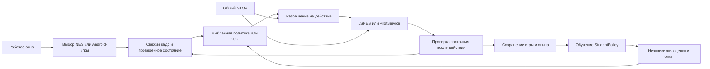

# План приёмки LocalPilot Harness

| Этап | Выполнение | Условие приёмки |
|---|---|---|
| 1. Рабочее окно | Собрать единый APK, открыть «Окружения» и нажать верхний STOP | Интерфейс показывает состояние реальных служб и причину STOP из координатора. [Сборка #207](https://github.com/GiVscSon/LocalPilot-Android/actions/runs/44908257071) прошла |
| 2. Управление вводом | Проверить конфликт стартов NES и Android, включая переходы между экранами и STOP во время действия | Один исполнитель в каждый момент. После STOP исполнители освобождают кнопки и отзывают разрешения. Журналы не фиксируют новых завершённых действий |
| 3. NES и модели | Запустить настоящий ROM, проверить выбранную GGUF, провести 256 шагов StudentPolicy, сохранить сеанс и восстановить его | Для каждого действия совпадают модель, кадр и ввод. Игровой результат подтверждается отдельно. Для LFM-VL отдельно проверяется изображение с mmproj |
| 4. Обучение | Обновить StudentPolicy на проверенных переходах, сравнить с активной политикой на независимых эпизодах | SHA весов меняется. Кандидат допускается после минимум 20 независимых пар, измеренного улучшения и проверки отката |
| 5. Android-игры | Начать с 2048. Проверить захват окна, ROI, правила игры, жест и следующее состояние. Для NFS отдельно реализовать наблюдение за трассой и схему руля/педалей | Жест подтверждается изменением игрового состояния подходящего профиля. Проверяется STOP при смене окна |
| 6. APK | Собрать ARM64, сверить SHA и подпись, пройти Android API 30/35/36 на телефоне и планшете в эмуляторе, затем проверить физический телефон | Установка, сохранение, восстановление и STOP подтверждены на одном исходном SHA. В отчёте есть ссылка на APK |

Первый прогон добавляет проверку верхней кнопки STOP на незапущенной NES через видимый интерфейс. Проверка работающей игры и отзыв ввода Accessibility остаются отдельными сценариями этапа 2.
