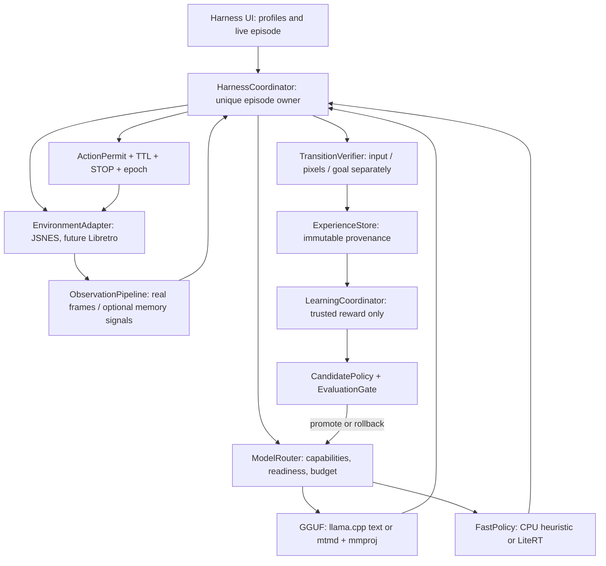

# LocalPilot Harness v1.0 — architecture RFC
Status: PROPOSED / documentation only. Base commit: 0acaf6d7e70bb2055a35185971ce2d1b3b849919 (PR #111).
Date: 2026-11-12. Target: one Android APK, ARM64, minSdk 30; POCO X7 Pro first physical device.

## 0. Invariant and scope

LocalPilot is an execution HARNESS for local agents, not a collection of independent ModelLab/GameLab screens. A model is a decision provider; a core is an environment; only one harness controller owns an episode and may authorize a bounded emulator input. It must observe *actual* game consequences and own real learning records. A downloaded model that has no bound consumer must be visibly labeled "installed, not active", never "working".

No Yandex mini-game simulators. Initial supported environment: in-app actual JSNES homebrew. User-provided ROMs can be imported manually; autonomous control on arbitrary ROMs requires explicit capabilities, observable goal/reward, a calibrated action map, and acceptance tests. Other console cores are future plug-ins, not fake UI placeholders.

STOP, single executor, InputPermit/ActionGate-like semantics, TTL/epoch fencing, UNKNOWN propagation, no OS input privilege for models, and fail-closed on invalid or late outputs remain mandatory. Android ACK or emulator ACK proves only input transport, never objective success. Never replace real feedback with synthetic successes.

## 1. One process, one orchestrator



Only HarnessCoordinator talks to EmulatorAdapter.step/act. ModelRouter provides suggestions, never invokes emulator or AccessibilityService. ModelLab is a view of ModelRegistry and ModelRouter, not a separate isolated engine. GameLab is a view of EnvironmentRegistry, not a separate agent. Training is called only after a verified transition.

### Existing code to reuse

- `shared/.../ConsoleAgentBridge.java`: existing process-local GGUF suggestion bridge; evolve toward typed ModelRouter; avoid second parallel singleton.
- `shared/.../ConsoleAgentPolicy.java`: strict ACTION grammar, STOP, no-ACK-as-reward; current four-step ceiling is a smoke-test mode only. Keep it there, introduce separate bounded production episode budgets in coordinator.
- `game-lab/.../NesEmulatorActivity.java` + `game-lab/src/main/assets/nes/index.html`: real JSNES frames, current frozen screenshot / bounded button loop, ROM identity. Extract reusable EmulatorAdapter without discarding working UI.
- `model-lab/.../ModelLabActivity.java`, `ModelLabStore.java`, `app/.../EmbeddedGgufRuntime.java`: checked GGUF/mmproj import, actual JNI text/vision, optional Vulkan, cancellation; relocate lifecycle ownership to an application-scoped ModelRegistry/ModelRouter.
- `app/.../PilotApplication.java`: application composition root. Do not add a second independent agent service.
- Existing STOP, audit and stage metrics should be reused; new records must not contradict them.

## 2. Capability contracts (interfaces, not implementation yet)

```java
interface EnvironmentAdapter {
    EnvironmentCapabilities capabilities();
    EpisodeStart reset(ResetRequest request);   // ROM hash, core version, seed/savestate optional
    StepResult step(ApprovedEmulatorAction action); // one unique writer, bounded emulated frames
    Observation observe(); // read-only, same epoch, immutable copy
    void stop(StopReason reason);  // release every held button
    Optional<SaveState> saveState(); // only if core supports verified snapshot
    void close();
}
interface ModelBackend {
    ModelCapabilities capabilities();  // TEXT/VISION/POLICY; CPU/VULKAN; action schema; limits
    ProbeResult probe(VerifiedModel model, ProbeInput sample); // real native invocation
    CompletableFuture<Proposal> infer(Observation obs, Goal goal, Deadline deadline);
    void cancel(RequestId request); // asynchronous; never marks complete before JNI ends
}
interface ExperienceStore {
    void append(Transition transition); // atomic, immutable, provenance-bound
    ReplayBatch sample(ReplayFilter filter);
}
interface LearningBackend {
    Eligibility check(ReplayBatch batch);
    CandidatePolicy train(ReplayBatch batch, Budget budget); // only supported algorithms
    EvaluationReport evaluate(CandidatePolicy candidate, HoldoutEpisodes holdout);
}
```

In Android Java, exact names/types can adapt to existing project style. The semantics and ownership must not change.

### Modes

- `STEP_MODE`: the emulator advances N frames only after an approved action; the framebuffer is frozen while a slow GGUF reasons. Stable repeatable learning / diagnosis. Game-time freeze must be explicit in evidence.
- `REALTIME_MODE`: emulation runs continuously; lightweight policy handles timely input. GGUF may periodically suggest a strategic goal, but any proposal older than its deadline or frame epoch is discarded. Never freeze a real-time session just because an LLM is slow.
- `MANUAL_MODE`: user control remains first-class; episode may be recorded with consent, but never mislabeled "agent played".

Not every core supports savestates or deterministic playback. Capability probing decides eligibility. A "replay" based only on screenshots is not equivalent to deterministic core replay.

## 3. Data schema (localpilot.transition.v1)

```json
{
  "schema": "localpilot.transition.v1",
  "episodeId": "unique-session-id",
  "sequence": 3,
  "provenance": "REAL_JSNES",
  "romSha256": "64-hex-rom-id",
  "coreId": "jsnes",
  "coreVersion": "2.1.0",
  "mode": "STEP_MODE",
  "modelId": "sha256:...",
  "policyVersion": "policy-0001",
  "observation": {
    "frame": 180,
    "epoch": "rom-session-123",
    "imageRef": "content-addressed-frame",
    "pixelHash": "123abcd0",
    "featuresVersion": "nes-v1"
  },
  "proposal": {"action":"RIGHT","durationFrames":8,"requestId":"req-3"},
  "permit": {"accepted":true,"ttlExpired":false,"stopRevision":7},
  "execution": {"inputAck":true,"newFrameSeen":true,"pixelsDiffer":true},
  "assessment": {
    "goalProgressConfirmed":false,
    "reward":null,
    "rewardSource":"UNKNOWN",
    "rewardConfidence":null
  },
  "terminated":false,
  "truncated":false,
  "truncationReason":null,
  "recordedAtElapsedMs":1234567
}
```

Fields may be versioned before implementation, but reward must remain nullable/UNKNOWN. PixelsDiffer=true does not mean reward>0. Gymnasium export is permitted ONLY for transitions with a validated numeric reward; exported step returns (observation, reward, terminated, truncated, info). Terminated means actual MDP/game ending; truncated means budget, deadline, thermal cutoff, forced STOP, or manual session stop.

A game profile may define a verified reward from ROM RAM variables or trusted score, lives, checkpoint/progression. Validate each source against screenshots and independent seeds. No reward hacking by farming animations, menu screens, or button ACK. Synthetic fixtures must carry `SYNTHETIC` provenance and never count as real episodes.

## 4. Model pipeline

Lifecycle: DISCOVERED -> HASH_VERIFIED -> RUNTIME_PROBED -> CAPABILITY_CHECKED -> BOUND -> ACTIVE, else INCOMPATIBLE / OFFLINE / BUSY / ERROR. UI must display *actual* status for every installed model, including the model currently producing actions.

- `GGUF_TEXT`: llama.cpp native: receives bounded structured observation, goal, legal actions, emits a grammar-constrained proposal (at minimum strict ACTION=... with parser). Unverified text never becomes a key press.
- `GGUF_VISION`: GGUF + matching mmproj, receives genuine NES RGB frame; never pretend text-only is image perception. Validate model family and projector compatibility before binding.
- `FAST_POLICY`: small action-value or classification policy, CPU-first; may later use LiteRT compiled inference after benchmark and actual tensor-contract verification.
- `HEURISTIC`: trusted baseline for comparison and fallback, not passed off as trained AI.
- Model errors or missing vision support => STOP or explicit safe fallback under user-enabled fallback profile. No silent switch.
- Native jobs serialized if llama.cpp runtime is process-wide; never kill/reload a JNI model from a lifecycle callback while another job uses it.

### Teacher / student

GGUF can be slow teacher or strategist: propose action from real observation, and write its proposal into data. A fast student can imitate good teacher demonstrations only after outcomes and trusted rewards are known. Imitation quality and objective-game reward are different metrics. Online updates train a separate policy artifact; they **do not mutate GGUF weights**. GGUF fine-tuning/LoRA is a later explicit, independently verified pipeline.

## 5. Learning runtime: a useful, real minimal implementation

MVP: small CPU `LinearQPolicy` / tile-coded Q-learning with low-dimensional, versioned game features from first built-in homebrew (player X, target X, score/lives if independently verifiable). Real samples (s,a,r,s',done) with known reward provider only; use a bounded experience buffer with train/validation split by episode and seed.

Separate three artifacts:
1. `ExperienceLog`: unmodified observations, actions, ACK, visual checks, provenance, reward evidence.
2. `CandidatePolicy`: newly learned weights/Q-values; never replace active policy while training.
3. `EvaluationReport`: holdout episode outcomes compared against pinned baseline. Promotion requires improvement on goal return/progress, no increase in safety stops, and repeated seeds; otherwise rollback.

Candidate starting gate for engineering tests (configurable and not a measured performance claim): >=20 holdout episodes across >=5 distinct seeds, at least 5% higher median validated return, no worse objective completion rate and no added STOP violations. For unknown rewards, all learning remains disabled; recording may continue.

Avoid falsely calling a ring buffer "learning". A real training pass must change a versioned policy hash and measurably alter its action distribution or value estimates on a fixed test vector. Never train on the holdout episodes, and do not auto-publish candidate weights.

## 6. Resource safety on POCO X7 Pro

- User can choose CPU vs Vulkan for compatible GGUF; GPU offload must be confirmed by native loaded layer count, device name, actual latency and error rate. Compiled Vulkan alone is not GPU usage.
- Default lightweight policy on CPU; no full-frame LLM inference at gameplay FPS.
- Bounded RAM/CPU budget and disk quota for models, images and replay logs; journals rotate, cleanup never deletes active model or unexported results without consent.
- Thermal `PowerManager.getCurrentThermalStatus` since API29. Pause discretionary training at high thermal severity, but always keep STOP responsive.
- Background training only by explicit opt-in; use WorkManager with BatteryNotLow, StorageNotLow and charging/idle policy as configured. WorkManager may defer or cancel work, so checkpoint training atomically.
- Avoid false guarantees of fixed 60 FPS or on-device PPO speed before real measurements.

## 7. Observability and UI

A single home screen: `PLAY` (core/ROM/profile), `MODELS` (installed/verified/active plus probe), `LEARN` (eligible data/real weight updates/evaluation), `EVIDENCE` (trace/frames/reward/STOP), `SETTINGS` (CPU/Vulkan and limits). These are views over the same coordinator, not independent subsystems.

Every live episode shows:
- model and policy version, capability and backend;
- last observation frame/epoch, action proposed and action actually authorized;
- input ACK, fresh-frame/pixel status and *separate* goal/reward status;
- reason for STOP, rejected stale action, trust source of reward;
- real training samples / candidate promotions; "no training data" if unknown reward.

## 8. Delivery stages and acceptance (one reviewed SHA per matrix)

P0: architecture, contracts, tests, source map. No APK claims.
P1: common HarnessCoordinator/EnvironmentAdapter over existing working JSNES. Prove step/reset, unique actor, STOP, late reply rejection, explicit terminated/truncated and bounded input. No regression of manual NES.
P2: ModelRouter reusing existing GGUF/vision, model probe and active binding statuses. End-to-end real on-device inference -> valid proposal -> NES core action -> new observation, not mocked.
P3: verified reward provider for ONE homebrew and real ExperienceStore. UNKNOWN never produces reward, no phantom trained states, reproducible capture.
P4: on-device lightweight training, holdout evaluation and atomic promotion/rollback with actual changed policy hash. Baseline comparison and replay provenance checks.
P5: realtime small-policy loop + optional slow GGUF strategist; performance, thermals and Vulkan measured on real phone; no expired actions.
P6: user-ROM capability profiles, licensed Libretro cores (after license review), state/replay support if verified; never claim arbitrary ROM training without goal integration.

Each stage must provide reproducible JVM/unit tests, real JSNES execution tests, Android 30/35/36 UI/instrumentation, artifact hashes, and where relevant signed physical POCO X7 Pro evidence. Different test signing keys can be used for a cleanly installed test package; never silently claim production update compatibility.

## 9. Evidence classifications

`BUILD_PASS`: APK compiles. `UI_PASS`: screens open. `INFERENCE_PASS`: actual model generates. `ACTION_PASS`: core executes bounded action. `TRANSITION_PASS`: fresh state observed. `GOAL_PASS`: trusted progress. `TRAINING_PASS`: policy actually updated. `GENERALIZATION_PASS`: holdout improves. `DEVICE_PASS`: target physical hardware confirms. None implies another.

## 10. Key external references (read against project-specific pinned versions)
- Gymnasium Env API: https://gymnasium.farama.org/api/env/
- Stable-Retro integrations and rewards: https://stable-retro.farama.org/integration/
- llama.cpp Android NDK: https://github.com/ggml-org/llama.cpp/blob/master/docs/android.md
- llama.cpp GBNF: https://github.com/ggml-org/llama.cpp/blob/master/grammars/README.md
- Libretro core API: https://docs.libretro.com/development/cores/developing-cores/
- Android thermal: https://developer.android.com/reference/android/os/PowerManager
- WorkManager constraints: https://developer.android.com/develop/background-work/background-tasks/persistent/getting-started/define-work
- LiteRT Android: https://developer.android.com/ai/custom

This RFC is a design plan, **not an implementation or proof of training**. Do not infer source functionality from these proposed interfaces.
