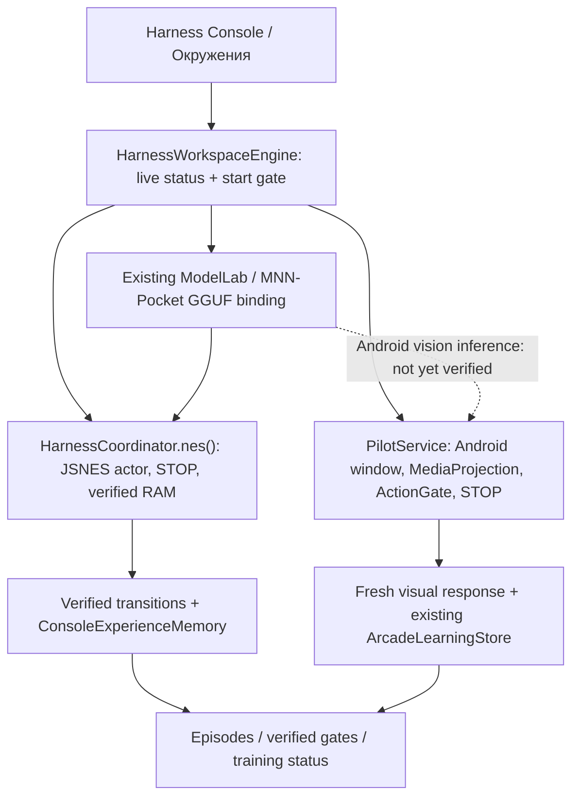

# LocalPilot Agent Harness: рабочее пространство, движки и подтверждение действий

Stage: operational workspace / E4 prep, **not** universal NFS autonomous play or completed G0–G6.

## One actual application, no duplicate executor

The **workspace** is not an image/mock: it reads the existing shared NES controller and the actual AccessibilityService, names their current owners and stop reasons, and dispatches to the existing environment activities. It never grants any gesture permit. Android gameplay remains owned by PilotService. The shared STOP calls each real owner and releases NES WebView input when needed.

## Current implementation scope

- Existing GamePicker can open genuine installed apps; no inference of control compatibility from the package or app label.
- Installed game selection passes the exact-window and profile admission gate introduced in #205. A configured profile continues through PilotService's current camera/gesture/semantic verifier.
- New `Окружения` tab shows real live controller state, NES epoch, active owner, selected model, Android package/profile/window/capture status, frame counter and semantic verification count (UNKNOWN shown as -1).
- **Production UI unblocker:** `MainActivity` now launches the real unified Harness Console whenever `UNIFIED_MODELLAB` is enabled, **not** only for emulator-test fixture variants (`HARNESS_TEST_FIXTURES`). ModelLab opens from the same APK; the standard non-unified build retains its explicit fallback. Reopening an existing Android overlay no longer resets active capture.
- The same console starts existing NES workflows and opens installed Android games, checks occupancy before routing, exposes ModelLab and actual experiences, and routes common STOP.
- A new `HarnessWorkspacePolicy` prevents starting the opposite environment while an active control session is detected; for all other entry paths, each engine's original independent STOP/TTL/InputPermit/epoch checks remain authoritative.

## Not yet implemented or proven

- No NFS scene detector, steering actuator contract, calibration or semantic race-win verifier. Do **not** map generic TRAFFIC blindly onto NFS.
- No MNN vision pipeline connected to Android gameplay; text GGUF RAM NES progress is not transferable proof.
- No proof of continuous exclusive game input from all entry paths (the control-plane start gate is a first defense, not a replacement for each executor's permits).
- No physical POCO X7 Pro run or signed release on this PR.
- No claim that GGUF weights are trained, or that ACK implies in-game reward.

## Gates for continuation

1. HOST_UNIT: compile the occupancy test and run source-linkage regression, with negative NFS/other-window cases inherited from #205.
2. ANDROID_BUILD: compile one unified APK on the exact merge/source SHA.
3. EMULATOR_ANDROID: open the real workspace and app picker, prove Android and NES STOP states and no cross-game input in API30/35/36.
4. PHYSICAL_ANDROID: capture frames and calibrate a genuine installed NFS variant using the game's actual touch controls; no model-generated gestures until scene/action schema and ROI are known.
5. VERIFIED_MODEL: introduce Pocket vision **only** after a backend capability check and validated model+projector; never substitute text inference for visual perception.

Canonical control tower: [#159](https://github.com/GiVscSon/LocalPilot-Android/issues/159). Model priority: Pocket first, Qwen3.5/LFM1.2B comparators, LFM350 diagnostic only. Local safety invariants stay unchanged.
