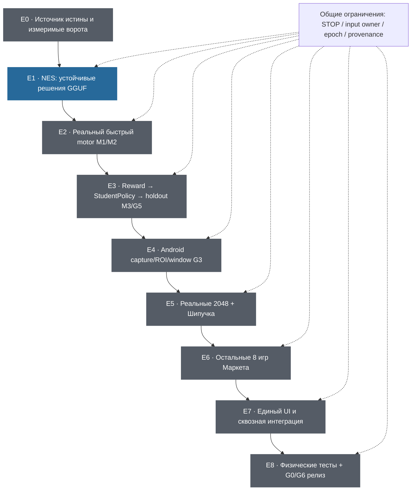
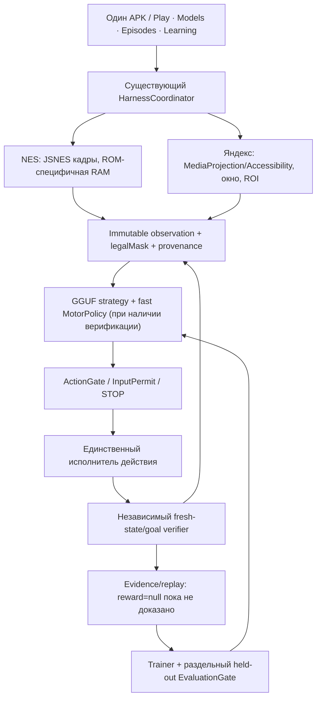
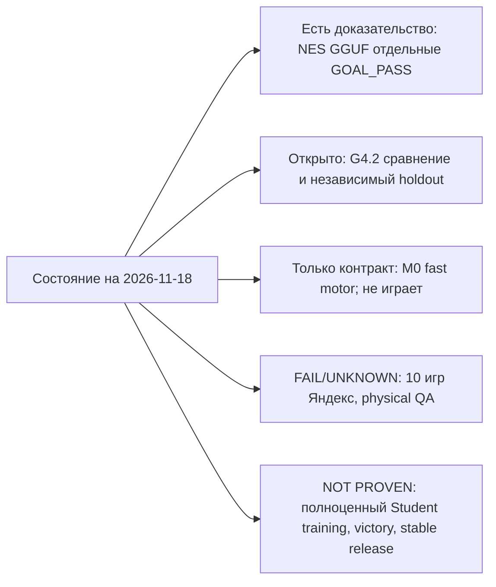

# LocalPilot: визуальная дорожная карта последовательной реализации

**Статус: DRAFT / COORDINATION ONLY.** Дата составления: 2026-11-18. Это схема этапов и критериев, не доказательство реализации.
**Базовый main:** `32838fde8c2432dd060f3cf2923d4dd1910c9553`. Перед каждым изменением заново проверять SHA main, #159, соответствующие PR и их CI.

## Источники истины и границы

- [Control Tower #159](https://github.com/GiVscSon/LocalPilot-Android/issues/159) координирует разработку.
- [Согласованные этапы C0–C3, G0–G6](LOCALPILOT-CONTROL-TOWER-STAGES.md), [Harness RFC](LOCALPILOT-HARNESS-RFC-v1.md), [Execution Plan](LOCALPILOT-HARNESS-EXECUTION-PLAN.md), [реестр](LOCALPILOT-SINGLE-SOURCE-OF-TRUTH.md) остаются нормативными. Обозначения E0–E8 ниже являются **представлением очереди**, не новыми конкурирующими воротами.
- Для игрового NES-контроля актуальны [G4.1 #194](https://github.com/GiVscSon/LocalPilot-Android/pull/194), [Pocket #195](https://github.com/GiVscSon/LocalPilot-Android/pull/195), [M0 #196](https://github.com/GiVscSon/LocalPilot-Android/pull/196), [G4.2 #198](https://github.com/GiVscSon/LocalPilot-Android/pull/198). Они **Draft** и не означают готовый релиз.
- Для Яндекс Маркета приёмка и регрессии учитываются в [Issue #69](https://github.com/GiVscSon/LocalPilot-Android/issues/69). Не засчитывать симуляцию вместо игры на телефоне.
- Между этапами обязательны неизменные STOP, TTL, epoch, единый InputPermit/ActionGate, проверенное окно/ROI и правило «ACK не доказывает игрового действия». ROM/model/weights SHA, provenance, дата и CI job у каждого результата.

## Граф 1. Последовательность и зависимости (без вымышленных дат)

**Порядок:** один **активный продуктовый gate** за раз. Независимые аудит/исправления безопасности допустимы, но не дают права перепрыгивать приёмку. G0 (происхождение APK) выполняется на *каждом* шаге, окончательное release-signing проверяется в E8. M0-контракт создан параллельно и не считается E2 PASS.

## Граф 2. Одна архитектура для обеих игровых сред

Не создавать второй эмулятор, Harness, JNI, trainer, отдельные демонстрационные игровые окна или фиктивные «выигрыши».

## Граф 3. Текущие доказательства (не проценты выполнения)

Доказательства отдельного игрового прогресса на проверенной ROM: Qwen3.5 300 score / 0 kills; LFM1.2B 100 score / 1 kill в [Actions #44263563770](https://github.com/GiVscSon/LocalPilot-Android/actions/runs/44263563770); MNN-Pocket GGUF 100 score / 1 kill в [Actions #44266929630](https://github.com/GiVscSon/LocalPilot-Android/actions/runs/44266929630). LFM350 в обычной приёмке остаётся FAIL (START + WAIT). Ни один из этих результатов не доказывает победу, устойчивый повторяемый выигрыш, мультимодальное восприятие или тренировку весов.

## Очередь с критериями перехода

### E0. Аудит и визуальная карта (данный PR, не G0 PASS)
**Вход:** main SHA, #159, документы G0–G6, M0–M5, открытые PR и #69.
**Действие:** сохранить единый граф, владельцев и блокеры; не дублировать уже существующие ветки.
**Выход:** документ доступен в Draft PR, графы корректно отображаются, очередность и pass/fail/not-run явные. Не считать E0 выполненным в main, пока PR не принят.

### E1. NES GGUF: от одного успешного эпизода к устойчивой политике (ACTIVE: #198)
**Вход:** фактический #194/#195/#198, одинаковые SHA исходника/ROM/model и восстановленные состояния.
**Действие:** закончить G4.2 диагностику пяти режимов A–E, независимый holdout только кандидатов B/C, проверить LFM350 WAIT loop; без подмены модели заранее заданными кнопками.
**Выход:** полный диагностический протокол, честный `NO_PROVEN_IMPROVEMENT` либо подтверждённый независимый прирост по существующему контракту #198 (≥5% медианы score, без ухудшения C-count/lives), плюс отдельная обычная игровая регрессия выбранной конфигурации. Несколько независимых результативных эпизодов обязательны до заявления «устойчиво играет», даже если эксперимент завершился без улучшения.
**Нельзя:** назвать `DIAGNOSTICS_COMPLETED` выигрышем или обучением.

### E2. Быстрый motor M1/M2 (PENDING, M0 контракт есть в #196)
**Вход:** E1 измерен и завершён. `FastMotorContract` не даёт прав на ввод самостоятельно.
**Действие:** M1: opt-in ROM-specific heuristic с отдельным `motorSource=HEURISTIC`, реальным исполнительным путём. Затем M2: realtime не ждёт GGUF; проверенное ограничение frame/action и отзыв после STOP.
**Выход:** ≥100 реально сопоставленных motor-переходов на точной ROM, 0 поздних действий, затем ≥1000 bounded motor decisions для M2 и p50/p95/p99 на реальном устройстве для *физических* утверждений.
**Нельзя:** маркировать эвристику обученной StudentPolicy, использовать frozen STEP gesture в REALTIME.

### E3. Реальная StudentPolicy и проверенное обучение (PENDING)
**Вход:** E2 реальные переходы и ROM-specific observation schema.
**Действие:** provenance-aware reward из доверенного состояния ROM, `reward=null` в неизвестных случаях; отдельные веса/действия для VOID, train PPO/GAE, перезапись только кандидатных весов.
**Выход:** hash весов до/после, проверенные обновления, ≥20 независимых парных holdout по актуальному контракту, улучшение без safety violations, rollback на FAIL. No-proven-improvement означает, что активные веса не меняются.

### E4. Исправление Android capture/ROI/window (PENDING, #69)
**Вход:** существующие PilotService, capture, ROI, gesture tests. Не переносить NES RAM на Android.
**Действие:** различить display/window/ROI/overlay, безопасно восстановить lifecycle согласия MediaProjection, потерю фокуса и 0-bounds, исправить `PANEL_COVERS_ROI`, захват 2048/Шипучки.
**Выход:** реальный свежий кадр и точные координаты окна, ни одной команды на UNKNOWN/устаревшее окно, проверяемые ошибки вместо бесконечных зависаний, API30/35/36 + полевой журнал.

### E5. Первые две игры Яндекс (PENDING)
**Вход:** E4 достоверен.
**Действие:** 2048: обнаружение плиток и подтверждённое слияние. Шипучка: три отдельные ROI (сетка, траектория, нижняя пушка/шар), подтверждённая стрельба.
**Выход:** для каждой из двух игр ≥5 подряд действий с независимым визуальным подтверждением на реальном устройстве, STOP после смены окна, полная трасса. Не путать с тренажёром.

### E6. Остальные восемь игр Яндекс (PENDING)
**Очередь:** Прыгун Ари → Мэтч Ворлд → Нащупай ход → Карканоид → Маркет Раш → Гошан → Гексон → Котобашня.
**Выход:** каждая механика имеет отдельную понятную obs/action schema, ≥5 подряд визуально подтверждённых действий на физическом устройстве, причины остановки и журнал; неподдерживаемые сценарии честно помечены. Никакой подмены TRACE_LINE/SWAP_MATCH3.

### E7. Полная интеграция (PENDING)
**Действие:** один APK и одна панель; game/model/library/play/episodes/learning указывают на те же идентификаторы, а не на разные mock-состояния.
**Выход:** одна и та же сессия проходит цепь выбора ROM или Android-профиля → observation → policy → action → verification → eligible learning или отсутствие награды. Предусмотрены STOP, cancel, manual takeover и safe restart.

### E8. Аппаратная приёмка и релиз (PENDING)
**Вход:** все предыдущие приёмочные условия.
**Действие:** физический POCO X7 Pro + планшет, согласованная матрица API30/35/36, same-SHA APK, память/температура/задержки, сертификат, неразрушающее обновление, issue #99.
**Выход:** `DEVICE_PASS`, `RELEASE_SIGNED`, подтверждение всех 10 профилей #69 и успешные независимые NES-эпизоды. Никакой релизной маркировки до этого.

## Стандарт выполнения каждого шага (для Codex/ChatGPT/Gemini)

1. Прочитать AGENTS.md, #159, текущий main, открытые PR и данный документ; зафиксировать SHA.
2. Выбрать **только первый незакрытый gate**; искать существующего владельца/PR, не начинать дублирующую реализацию.
3. Сформулировать одну проверяемую гипотезу, отрицательный тест и fail-closed критерий.
4. Вносить минимальное изменение в один новый Draft PR на актуальной правильной базе.
5. Получить Actions job и точный source/tested merge SHA; отделить HOST_UNIT, EMULATOR_ANDROID, REAL_MODEL_NES, VERIFIED_TRAINING и PHYSICAL_ANDROID.
6. При FAIL сохранить воспроизводимые логи и блокер, остаться на текущем этапе. Не перескакивать вперёд.
7. При PASS зафиксировать evidence в #159 и в реестре, затем открыть следующий gate.

**Ближайшее действие:** завершить и оценить G4.2 discovery/holdout в уже открытом #198. Новый M1-код не писать, пока E1 не измерен. Вести Android #69 как отдельную очередь ошибок с подготовкой capture-приёмки, но не выдавать её за выполненный E4.
