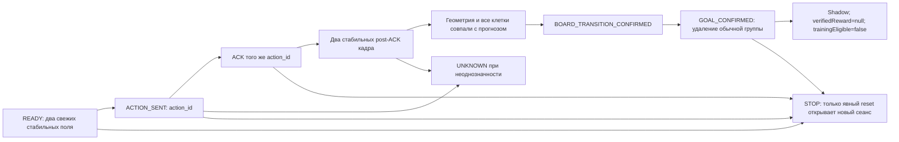

# Визуальные агенты: проверенные источники и исполняемый следующий шаг

Проверено 14.11.2026. База изменений: main `8b6cfca368f991aa6eff28af69b72d77c6b5b304`,
0.8.2/code54. Численные результаты авторов не являются результатами LocalPilot.

| Первичный источник | Что пригодно | Граница доказательств |
|---|---|---|
| [RM-VLM: From Natural-Language Task Descriptions to Vision-Grounded Reward Machines](https://arxiv.org/abs/2611.08308) | Проверяемые события и автомат прогресса вместо награды за изменение картинки | В LocalPilot нет интегрированного RM-VLM/VLM-верификатора |
| [Adaptive-Group Process Rewards for GUI Agents](https://arxiv.org/abs/2610.17710) | Оценка законченной комбинации действий | Перенос GRPO-результатов на наш PPO не проверен |
| [YOLO26](https://github.com/ultralytics/yolo26), [документация](https://github.com/ultralytics/ultralytics/blob/main/docs/en/models/yolo26.md) | Отдельное измерение recall мелких объектов и задержки всего цикла | Нет размеченного игрового набора/измерений POCO; AGPL/Enterprise требуют отдельного решения до распространения |
| [GAE Falls Short in Imperfect-Information Self-Play Reinforcement Learning](https://arxiv.org/abs/2605.19235) | Контроль дисперсии advantage, KL и качества критика | Доказательства для карточных игр не доказывают улучшение NES/2048 |
| [MAI-Gym](https://arxiv.org/abs/2610.20939), [код](https://github.com/Tongyi-MAI/MAI-Gym) | Общий протокол эпизода при раздельной аттестации сред | Заявленные 20 тысяч сред и рост 28.8→48.1% — результаты авторов |
| [Agentic Reward Modeling: Verifying GUI Agent via Progressive Trajectory-Grounded Interaction](https://arxiv.org/abs/2602.00575) (VAGEN) | Дополнительное наблюдение неоднозначного результата без повторного жеста | Верификатор также может ошибаться; его задержка не измерена в нашем игровом цикле |

Существование источников, названия и основные механизмы сверены по HTTP-доступным
страницам arXiv и репозиториям. Это не независимое воспроизведение их бенчмарков.
YOLO не добавлен в APK; GAE не заменён экспериментальным алгоритмом.

## Встроенный шаг: событийный наблюдатель «Шипучки»

Реализован небольшой детерминированный автомат в существующем `BubbleSession`.
Это собственный shadow-наблюдатель, вдохновлённый идеей событийных наград.
Он не генерирует автоматы через LLM и не распознаёт полёт снаряда.



`beforeFrame`/`afterFrame` здесь — timestamps захвата в сеансе, а не глобальные
идентификаторы кадров. `sessionGeneration` — поколение BubbleSession, не epoch
ActionGate. Callback дополнительно сохраняет существующую проверку gate epoch.
Положительная shadow-оценка требует предсказанного удаления минимум трёх обычных
шаров и сохранения количества клеток с учётом выстрела/удалений/падений.
Она не означает выигрыш, изменение очков игры или VERIFIED_REAL. Специальные
клетки и неподдерживаемые механики не получают доверенных наград.
STOP очищает текущую оценку. Старый ACK не может открыть новый выстрел.
ActionGate, InputPermit, TTL, ROI и проверка окна остаются владельцами допуска.

Один вход через существующий оркестратор:

```sh
python3 scripts/localpilot.py unified event-audit
```

Выход: `build/reports/unified-script-engine/event-audit/event-audit.{json,csv,md}`.
JSON содержит SHA исходников, признак незакоммиченных изменений и checksum CSV.
CI требует чистый checkout для отдельного этапа event-audit. Общий исторический
конвейер с overlay явно сохраняет `source_dirty`; его APK не получает статус
побитовой сборки исходного дерева только за совпадение commit SHA.

## Матрица исследований и критерии следующего шага

| Эксперимент | Сейчас | Условие продвижения |
|---|---|---|
| Контракт переходов | 200 синтетических сценариев, 1658 assertions; 19 ожидаемых shadow-целей, 0 ложных | Нулевые нарушения STOP, корреляции ACK, устаревших/чужих кадров |
| Аудит 200 настоящих переходов | NOT RUN; доступных размеченных записей нет | Сверить реальные frame/action/window/epoch/ACK/STOP и независимую разметку результата; не публиковать частные кадры |
| Событийная награда | Только shadow, доверенных наград 0 | Независимая разметка настоящих игровых событий; отдельная проверка false positives/negatives |
| Детектор против текущего зрения | NOT RUN | Один размеченный набор/ROI/device; recall, ошибки координат, capture-to-decision p50/p95; решение по лицензии |
| PPO/GAE против альтернативы | NOT RUN | Пять одинаковых seed, раздельные training/validation, KL/variance/success; отсутствие регрессии до активации |
| Online RL | Существующие NES leases/version gates; новая Bubble-оценка изолирована | Не обучать на UNKNOWN/ACK; проверять SHA, policy version, возраст траектории и откат |

Синтетические сценарии включают правильное удаление, простое размещение, ACK без
наблюдения, наблюдение без ACK, один post-ACK кадр, устаревшие кадры, чужие клетки,
изменённую геометрию, инвалидированный контекст, истечение срока и STOP.
163 изменения массива клеток нельзя приписать подтверждённой цели в этих
сценариях. Это демонстрация опасности примитивного changed-board proxy,
**не** измеренный pixel benchmark и не частота ошибок настоящей игры.
Проверка попытки `BubbleSession.sent()` после STOP — контракт локального
контроллера; она не подменяет Android E2E с реальной отправкой жестов.

Стабильный релиз остаётся заблокирован совместимой постоянной подписью и
физической приёмкой телефона/планшета. Зелёный тест автомата эти требования не закрывает.
